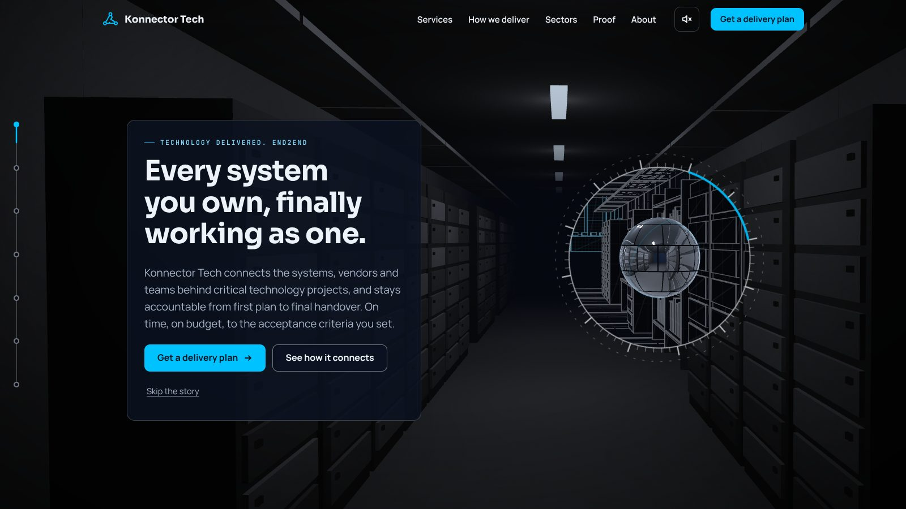
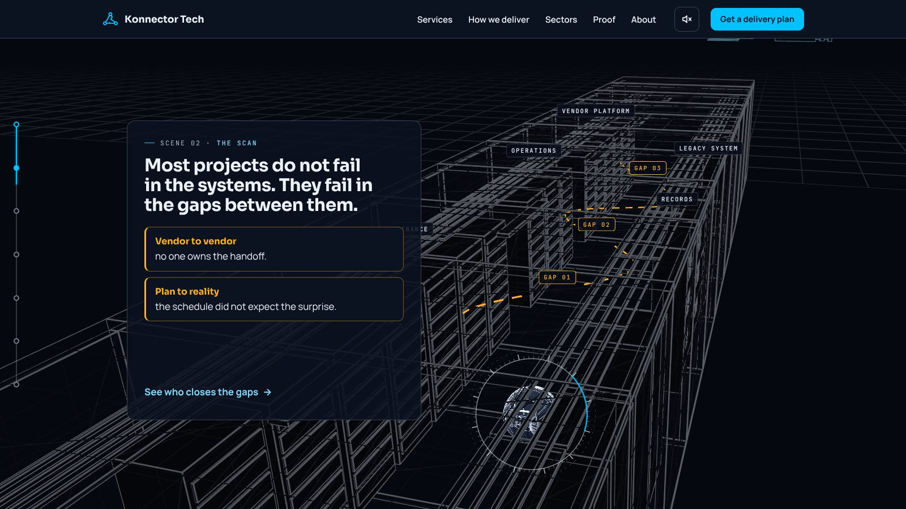
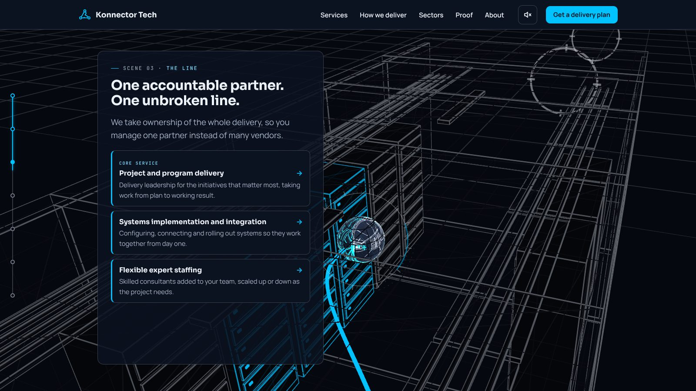
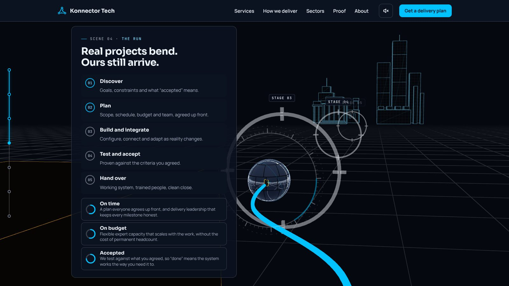
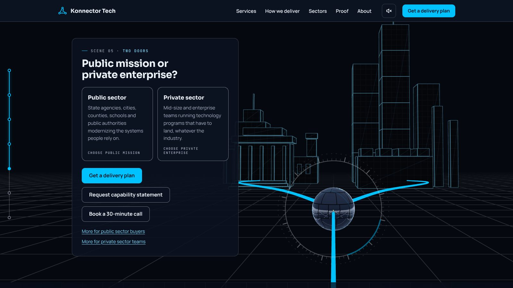
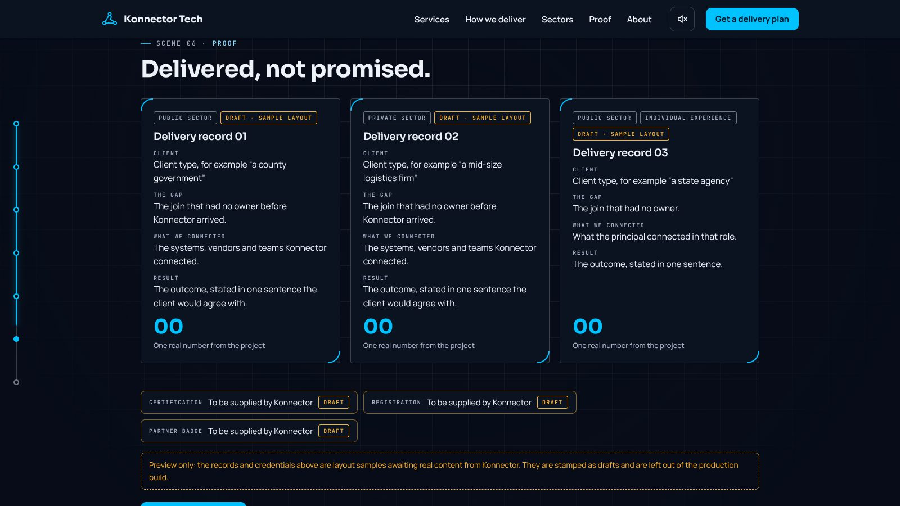
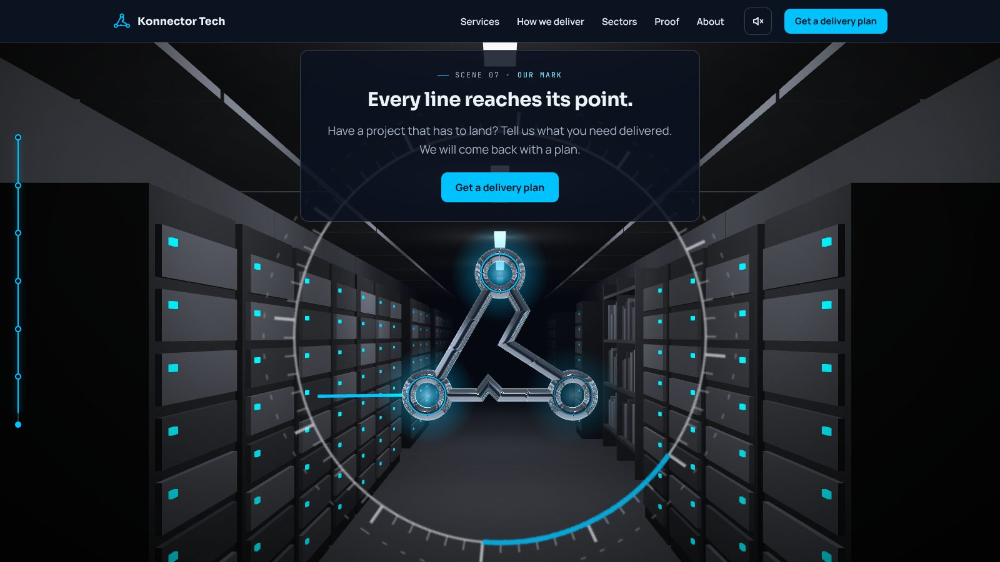

# Gate 1: storyboard and final copy

For sign-off before any further 3D work. Nothing in this folder changes the site.

**How to read the frames.** Each frame is a capture of the current build on the Full tier at 1600 × 900. They show
composition, camera and copy placement. They do **not** yet show the final look: the corridor and sphere are still
built in code. "To change" lists what each scene still owes the script. Signing off a frame approves its
composition and copy, not its present art.

## Scene 1: Arrival (the hook)

- **Script:** dim equipment corridor, near black-and-white, flickering strip light. Sphere glides in and stops right of centre. Three seams pulse cyan and trace the triangle. Scanner ring appears. Lens can be dragged; pointer shifts reflections.
- **Frame shows:** all of the above in position. Sphere is about one sixth of screen height. Headline is page text and paints first.
- **To change:** real mirror chrome reflecting a baked-light corridor (the present sphere reads as dark glass). Richer corridor: cable trays, old terminal and records shelf visible from this camera. Bloom on the seam pulse.

## Scene 2: The scan (the problem)

- **Script:** radar arm turns from the sphere; each pass turns more of the room to blueprint. Five labelled systems. Dashed amber links, three with a visible gap. Hover or tap a gap to enlarge its label.
- **Frame shows:** blueprint with five labels, amber links, three gap markers, gap labels as page text.
- **To change (needs your call):** the camera lifts **outside** the corridor here so the five systems spread across the screen. The script keeps the camera in the room. Staying inside is truer to the script but crowds the five labels near the vanishing point. Options: (a) keep the lift, (b) stay inside and widen the corridor into a room so the systems sit side by side. I recommend (b) once the Blender room exists.

## Scene 3: The line (the promise and the services)

- **Script:** sphere travels gap to gap; a solid cyan line follows; amber dashes turn cyan; systems light up. Four service panels dock onto the line one at a time. Each panel links to its service page.
- **Frame shows:** line following the sphere, systems lighting cyan as they connect, panels docking in step with the scroll.
- **To change:** panels should visibly dock **onto the line** (a leader from each panel to its point on the line). Same camera decision as scene 2.

## Scene 4: The run (the method and the three promises)

- **Script:** camera looks along the line like a track. Five ring gates lock with a quarter turn and light cyan. Amber block rises between gates 2 and 3; the line bends around it. Three dials fill; Accepted turns green at gate 4. Jump between gates from the rail.
- **Frame shows:** track, gates locking in step with the stage list, the bend, three dials.
- **To change:** the amber block must be clearly in frame when the line bends (it is behind the camera here). Gate labels carry the stage **name**, not only "Stage 03". Rail gains a tick per gate inside scene 4.

## Scene 5: Two doors (who it is for)

- **Script:** track ends at a blueprint skyline: city hall, school, courthouse left; office towers and a plant right. Line splits in two. Choice brightens one side and sets proof, form sector and the secondary button.
- **Frame shows:** all of it. Choice is kept for the session and accepted from the page address.
- **To change:** fix 5 from the review: until the booking link exists, the private-side button reads "Request a call"; until the PDF exists, the public-side button reads "Request capability statement". Neither pretends to be a booking page or a download.

## Scene 6: Proof (the evidence)

- **Script:** blueprint dims to a quiet grid. Proof cards slide in as delivery records framed by thin ring corners. Credentials strip below. Normal scrolling, 3D rests. Must not launch with placeholder text.
- **Frame shows:** quiet grid, three record frames, credentials strip, all stamped DRAFT.
- **To change:** nothing in layout. Content is yours to supply. The production build already fails on fewer than two real records, no public + private pair, or no confirmed credential; it will also fail on **any** remaining draft item (review fix 4).

## Scene 7: The transformation (logo reveal and the ask)

- **Script:** sweep runs in reverse; corridor returns with steady lights and a cyan status light on every rack. Sphere rises to centre, plates unfold showing the mechanism, lock as the mark. Line joins the first node; three nodes light. Ring widens to frame the form.
- **Frame shows:** lit corridor, status lights, finished mark, line arriving at the first node, three node glows, widening ring.
- **To change:** plates and mechanism animated in Blender (30 to 40 rigid plates, pistons and cylinders). Mark sits higher so it is fully clear of the form. Brushed chrome with cyan edge light.

---

## Final copy

Signature phrases are kept exactly. All of this is page text and reads with the 3D off.

| Where | Copy |
| --- | --- |
| Top bar | Services · How we deliver · Sectors · Proof · About · **Get a delivery plan** |
| Scene 1 label | TECHNOLOGY DELIVERED. END2END |
| Scene 1 headline (A, default) | Every system you own, finally working as one. |
| Scene 1 headline (B, for the test) | Projects fail in the gaps between systems. We own the gaps. |
| Scene 1 support | Konnector Tech connects the systems, vendors and teams behind critical technology projects, and stays accountable from first plan to final handover. On time, on budget, to the acceptance criteria you set. |
| Scene 1 buttons | **Get a delivery plan** · See how it connects · Skip the story |
| Scene 2 headline | Most projects do not fail in the systems. They fail in the gaps between them. |
| Scene 2 system labels | Finance · Records · Operations · Legacy system · Vendor platform |
| Scene 2 gap labels | Vendor to vendor: no one owns the handoff. / Plan to reality: the schedule did not expect the surprise. / Build to sign-off: 'done' was never defined. |
| Scene 2 link | See who closes the gaps |
| Scene 3 headline | One accountable partner. One unbroken line. |
| Scene 3 support | We take ownership of the whole delivery, so you manage one partner instead of many vendors. |
| Scene 3 panel 1 (core) | **Project and program delivery.** Delivery leadership for the initiatives that matter most, taking work from plan to working result. |
| Scene 3 panel 2 | **Systems implementation and integration.** Configuring, connecting and rolling out systems so they work together from day one. |
| Scene 3 panel 3 | **Flexible expert staffing.** Skilled consultants added to your team, scaled up or down as the project needs. |
| Scene 3 panel 4 | **Technology sourcing.** Where a project needs it, we source and integrate the technology, so you deal with one partner, not many vendors. |
| Scene 4 headline | Real projects bend. Ours still arrive. |
| Scene 4 gates | **Discover:** Goals, constraints and what "accepted" means. / **Plan:** Scope, schedule, budget and team, agreed up front. / **Build and integrate:** Configure, connect and adapt as reality changes. / **Test and accept:** Proven against the criteria you agreed. / **Hand over:** Working system, trained people, clean close. |
| Scene 4 dials | **On time:** A plan everyone agrees up front, and delivery leadership that keeps every milestone honest. / **On budget:** Flexible expert capacity that scales with the work, without the cost of permanent headcount. / **Accepted:** We test against what you agreed, so "done" means the system works the way you need it to. |
| Scene 4 link | What you receive at each stage |
| Scene 5 headline | Public mission or private enterprise? |
| Scene 5 public card | **Public sector.** State agencies, cities, counties, schools and public authorities modernizing the systems people rely on. |
| Scene 5 private card | **Private sector.** Mid-size and enterprise teams running technology programs that have to land, whatever the industry. |
| Scene 5 buttons | **Get a delivery plan** · public: Download capability statement (or "Request capability statement" until the PDF exists) · private: Book a 30-minute call (or "Request a call" until the link exists) |
| Scene 6 headline | Delivered, not promised. |
| Scene 6 record fields | Client · The gap · What we connected · Result · one number |
| Scene 7 headline | Every line reaches its point. |
| Scene 7 support | Have a project that has to land? Tell us what you need delivered. We will come back with a plan. |
| Form fields | Your name · Work email · Organization · Sector (Public sector / Private sector / Not sure yet) · What do you need delivered? · When does it need to land? (optional) |
| Form button | **Send and get my plan** |
| Under the button | We reply within one business day. Or email george@konnectortech.com. Privacy notice |
| Confirmation | Thank you, [first name]. Your enquiry is with us. Here is what happens next: 1. Your enquiry goes straight to our delivery team. 2. We reply to [email] within one business day. 3. If we need more detail to shape your plan, we will ask in that reply. |
| Send failure | We could not send your message. Nothing you typed has been lost. Please try again, or email george@konnectortech.com. |
| Rail ticks | Arrival · The scan · The line · The run · Two doors · Proof · Transformation |

**Copy needing your decision**

1. Hero headline for launch: A or B (A is live in the preview).
2. Reply promise: "one business day" is the script's recommendation. Confirm the team can always keep it.
3. Scene 3 panel 1: the current site's sentence was longer; this is shortened to one sentence. Confirm.
4. Supporting-page copy (four service pages, How we deliver "you receive" lists, sector pages, About, privacy notice) was written from the current site's wording and is in `content/` and `src/app/`. It needs your read before Gate 2.

---

## Two decisions the review asked me to raise before building

### A. Blender assets: they can be made here

Blender 5.3 installs in this environment as a Python module and runs headless. So the script's pipeline is
available: model the corridor, bake lighting with Cycles, export glTF, compress with Meshopt, encode textures to KTX2,
animate the plate transformation as one clip.

Limits to know before you approve it:

- **Modelling is scripted, not hand-sculpted.** Think precise architectural CAD, not a film set dresser. Hard-surface things (racks, trays, terminal, shelves, plates, pistons) suit this well.
- **No graphics card here.** Light baking runs on 4 processor cores, so each bake takes minutes, and iterations are slower than in a studio.
- **I judge the result from rendered stills,** which I will share at the art gate.

If the stills at that gate fall short, the fallback is a 3D artist replacing the `.glb` files; the code will not need to change.

### B. Stack: React Three Fiber + GSAP ScrollTrigger, or the current plain three.js

| | Script's stack (R3F + GSAP) | Current (plain three.js, native sticky) |
| --- | --- | --- |
| Matches the script | Yes | No |
| First-load size | Same (3D loads after first paint either way) | Same |
| 3D download | About 215 KB compressed (my estimate) | 137 KB compressed (measured) |
| glTF models and Blender animation clips | Ready-made loaders and helpers | Hand-wired |
| Next developer | Familiar to most creative front-end developers | Must learn a custom engine |
| Cost to switch | Rewrite of the engine, about one phase, done together with the art | None |

**Recommendation: switch to the script's stack,** and do it in the same phase the Blender assets arrive, because
the engine has to be reworked to load models and play the animation clip anyway. Both stay inside the 1.5 MB Light budget.

---

## Phases and gates from here

| Phase | Work | Gate (I stop and wait) |
| --- | --- | --- |
| 1 | This document | Storyboard and copy signed off; decisions A and B answered |
| 2 | Tiers and truthful buttons: full story by default, Light for integrated graphics, step down before falling back, "Play the story", tier test matrix; "Request a call" path; production check fails on any draft item, missing PDF or missing booking link | Tier matrix and build-check evidence |
| 3 | Grey-box timing on the agreed stack: seven scenes at about eleven screen heights, camera decision from scene 2 applied | Story reads on desktop and phone |
| 4 | Final art: Blender corridor, chrome sphere, plate animation, grain, vignette, bloom | Stills and recordings of all seven scenes against "sees, reads, can do" |
| 5 | Hardening: accessibility pass, budgets, real-device notes | Every acceptance criterion with evidence |
