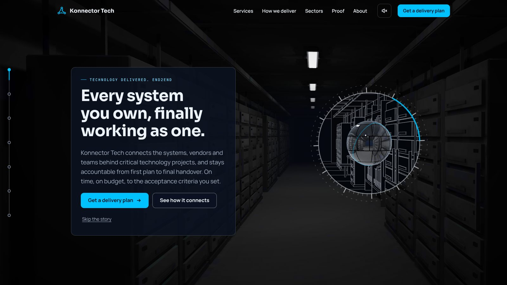
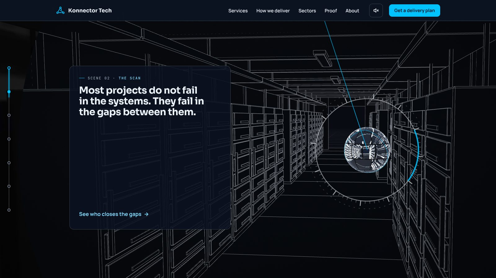
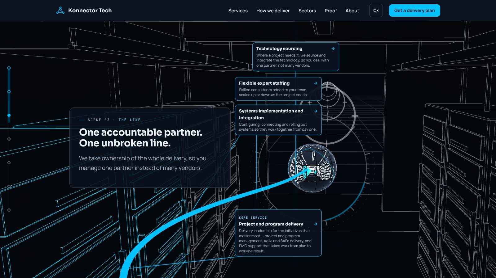
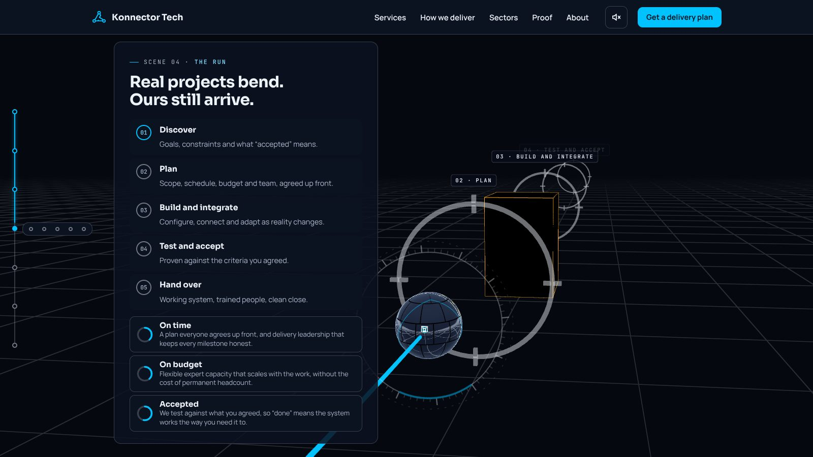
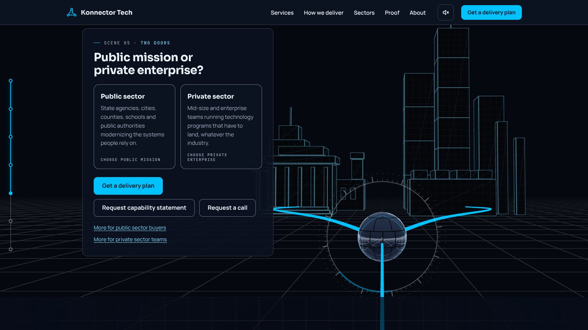
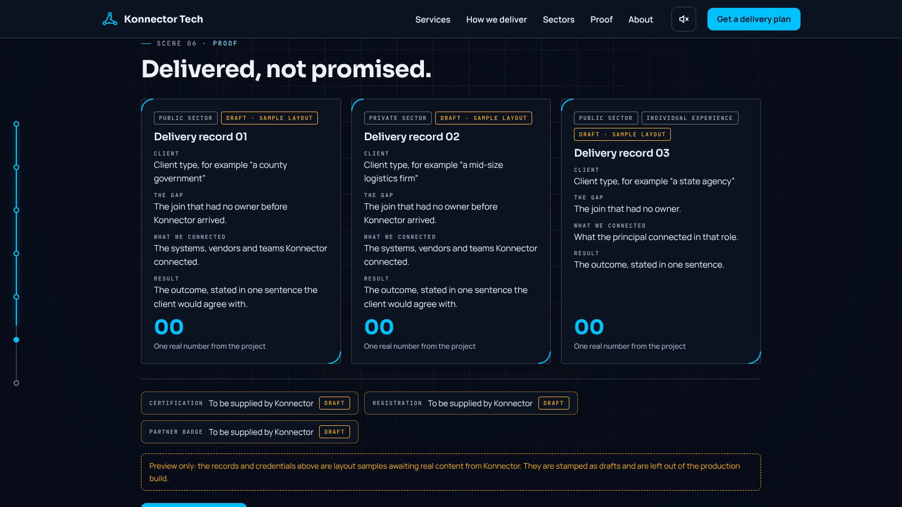
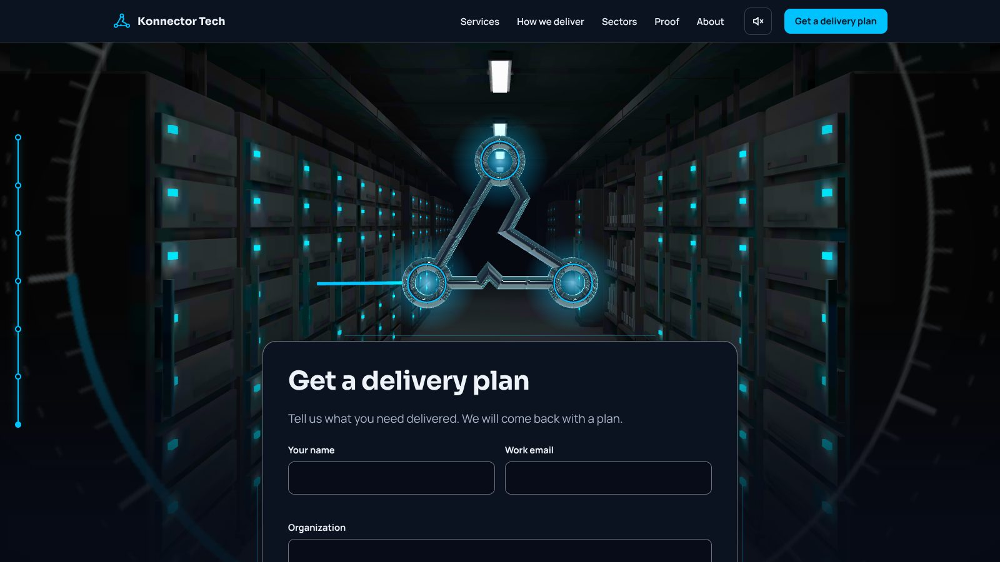
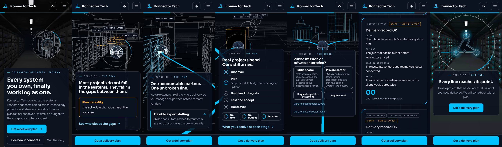

# Phase 3 gate: grey-box story

**Gate:** the story reads clearly on a desktop and a phone.
**Result: signed off on 11 Nov 2026**, at the owner's request ("if it fits the script and overall plan, go ahead with the sign-off"),
after the one failing item was fixed. The art is first-pass and not locked.

**Review against the script's Phase 3:** "Build the scroll timeline, camera path, sweep, lens and line using simple
grey shapes in place of final art. Gate: the story reads clearly on a desktop and a phone."

| Script item | Fits? |
| --- | --- |
| Scroll timeline: one scroll value, native scrolling, sticky sections, wheel never taken over | Yes |
| Camera path through all seven scenes, inside the room in scenes 2 and 3 | Yes |
| Sweep, driven by the scroll, forward in scene 2 and in reverse in scene 7 | Yes |
| Lens on the sphere, draggable on desktop | Yes (drag not exercised by a test) |
| The line, drawn in step with the scroll, never broken | Yes |
| Reads clearly on a desktop | Yes |
| Reads clearly on a phone | Yes after the scene 5 fix below. Two limits remain and are listed, not hidden. |

Frames were captured from the running build: desktop at 1600 × 900 on the Full tier, phone at 390 × 800 on the Light tier.
All 35 browser tests, 10 form tests and the budgets pass.

## What changed in this phase

| Item | Result |
| --- | --- |
| Stack: React Three Fiber + GSAP ScrollTrigger, one ScrollTrigger per scene feeding one story time | Done |
| Camera stays inside the room in scenes 2 and 3 | Done |
| Story length on desktop | 10.7 screen heights (target about eleven) |
| Scene 2: the radar sweep now runs while the text panel is pinned, then the links, labels and gap labels appear | Done |
| Scene 3: all four service panels leave the side card, dock onto the line and ride it behind the sphere. Technology sourcing appears. Each is still a real link. | Done on desktop. On phones one panel shows at a time in the text card. |
| Scene 4: skyline not drawn until scene 5; amber block in frame at the bend; gate labels carry the stage name; gate ticks on the rail | Done |
| Scene 7: the mark lifts, the form rises beneath it, and the ring frames both; call and email sit under the form | Done |

## Desktop

| Scene | Frame | Reads clearly? |
| --- | --- | --- |
| 1 Arrival |  | Yes for layout. Too dark for the sphere to read as chrome (Phase 4). |
| 2 The scan |  | Yes. Frame is mid-sweep, with the radar arm showing. |
| 3 The line |  | Yes. Four panels on the line. |
| 4 The run |  | Yes. |
| 5 Two doors |  | Yes. |
| 6 Proof |  | Yes (draft content). |
| 7 Transformation |  | Yes. Mark above, form in view, ring around both. |

## Phone

| Scene | Reads clearly? |
| --- | --- |
| 1, 4, 6, 7 | Yes |
| 2 The scan | Mostly. The five labels crowd in a corridor this narrow. |
| 5 Two doors | Yes, after a fix: the card is now short enough that the skyline, the sphere and the split line show above it. |
| 3 The line | Yes, with a limit: on a phone the service panels show one at a time in the text card, not on the line. |

## Not verified

- Motion on real devices. Frames are stills; the earlier recording predates this phase.
- Frame rate. This environment renders in software, so 60 and 30 frames per second cannot be measured here. That is the Phase 4 gate.
- Real phones, Safari and Firefox.

## Carried to Phase 4 (final art)

- Light levels in scene 1 so the mirror sphere has something to reflect; triangle seams visible.
- Widen the corridor into a room so the five system labels separate (owner decision).
- Plate design for the transformation (owner decision at the art gate).
- Bloom, grain and darkened edges on Full; the 8-second video re-exported from final art.
- Light tier is at 1.495 MB of 1.5 MB: any added art needs savings elsewhere.
