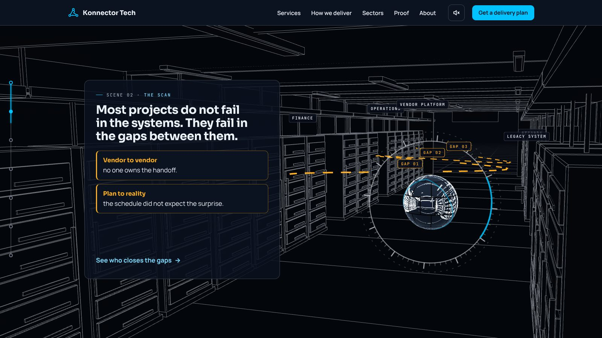
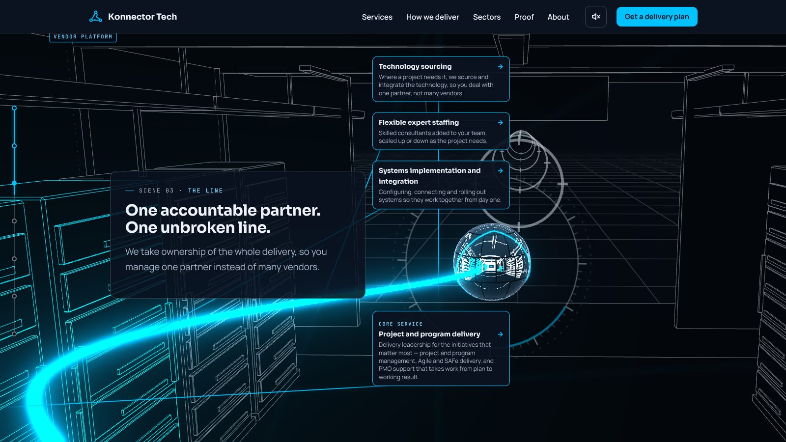
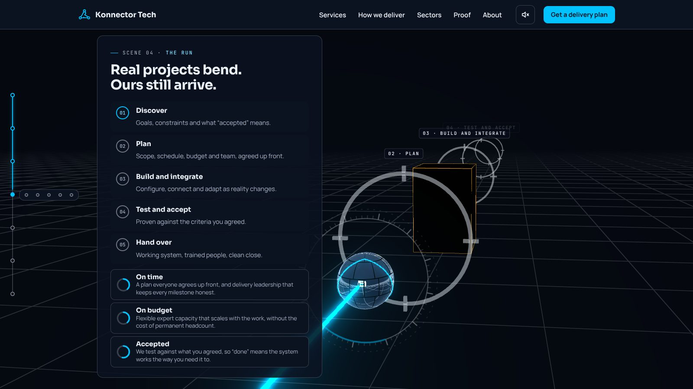
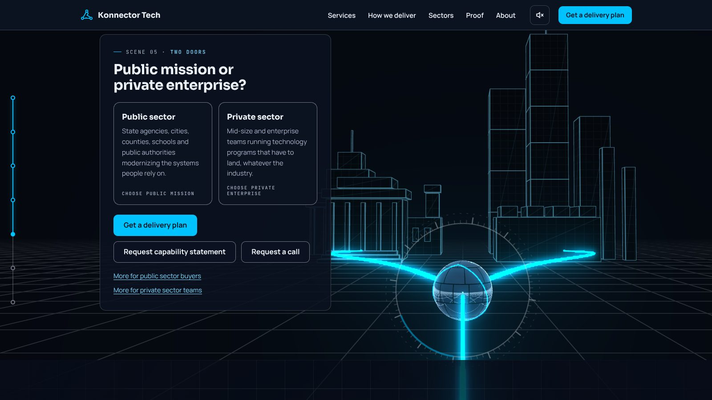
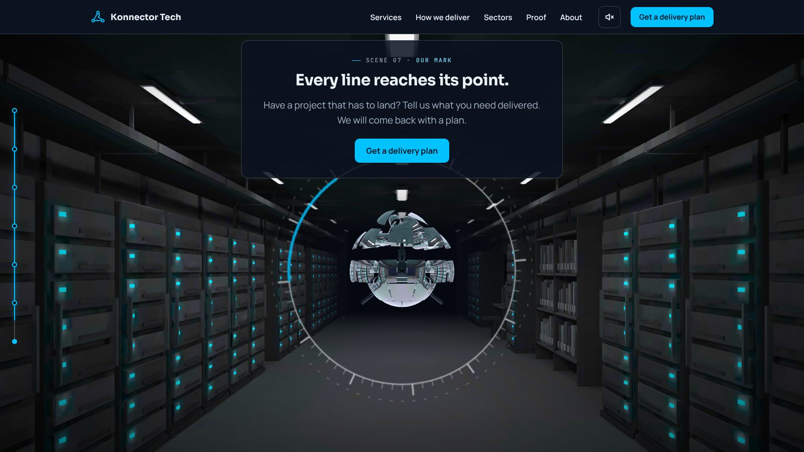
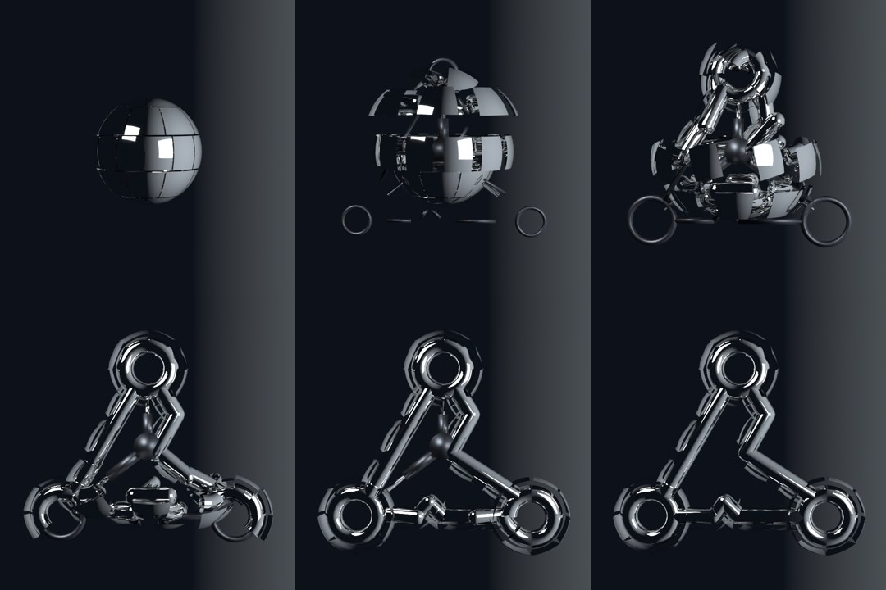
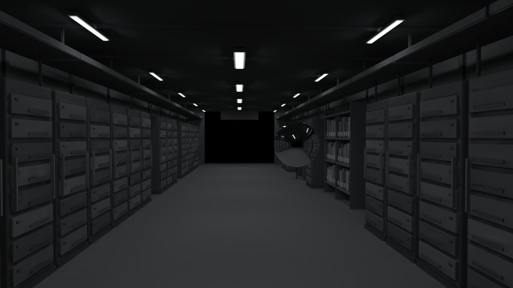

# Phase 4 gate: final art

**Gate:** the frame-rate budgets hold on the Full and Light tiers (60 frames per second on Full, never under 30 on Light).
**Status: not signed off. Two things only the owner can settle are listed at the end.**

The art in this phase follows my recommendations where the owner had not chosen. It is not locked.

## What changed

| Script item | Result |
| --- | --- |
| Corridor modelled in Blender with lighting baked into textures | Done. Two bakes: dim (scene 1) and lit with cyan status lights (scene 7). The wider room and brighter scene 1 are approved and locked. |
| glTF with Meshopt compression and KTX2 textures | Done on Full (2048 px KTX2). **Light tier uses 640 px JPG textures instead**, so phones skip the 256 KB KTX2 decoder. |
| Same model drawn with two materials, chosen per pixel by a mask of lens, sweep and blend | Done. The baked mesh is the real look; a Blender-exported line set is the blueprint. |
| Mirror-chrome sphere reflecting an environment rendered from the room; three seams tracing the triangle | Done. The seams glow cyan on the sphere's face. |
| Transformation: 30 to 40 rigid plates that slide, rotate and unfold to show pistons and cylinders, then lock as the mark | Done as decided: **36 rigid plates, no bending.** Each plate is one rigid part: a patch of the sphere's shell with one piece of the mark fixed under it. It lifts off, turns over, travels and clamps onto an inner frame pushed out by three pistons. The locked plates form the mark; the shell patches sit edge-on behind it like fins. One clip, 4 seconds, scroll-driven on desktop, self-playing on phones. |
| Bloom on cyan, Full only | Done as decided: **selective bloom** on the line, the triangle seams, locked rings and the mark's three nodes only. The white strip lights are not bloomed. The Light tier keeps the soft halo and node glow as its stand-in. |
| Grain and darkened edges on Full only | Done (as overlays). |
| Sound, off by default | In place: room hum, click when rings lock, rising tone for the transformation. |
| One still per scene for brief mode, and the share image | Re-rendered from this art. |
| 8-second logo reveal video | Re-exporting with the rigid plates (`public/media/logo-reveal.mp4`). |

## Review fixes (11 Nov 2026)

| Asked | Result |
| --- | --- |
| Scene 2: all five system labels separate | Done. Labels are kept apart on screen and clear of the text panel. |
| Scene 2: all three gap labels show in the card | Done. They now appear earlier, while the card is pinned. |
| A test that exercises the step-down ladder | Done. It simulates slow frames and checks Full, then Light, then Light at lower resolution, then brief mode. |
| Light 1.5 MB budget as a CI check, with headroom | Done. CI runs the budget check on every push. Light is now 1.12 MB (was 1.495 MB). |
| Frame-rate readout on the preview only | Done. `?fps=1` and the slow-frame simulation are compiled out of production builds. |

## Frames (desktop, Full tier)

| Scene | Frame |
| --- | --- |
| 1 Arrival |  |
| 2 The scan: five labels, three gap labels |  |
| 3 The line, with bloom on the line |  |
| 4 The run |  |
| 5 Two doors |  |
| 6 Proof |  |
| 7 Plates opening |  |
| 7 Plates clamping onto the frame |  |
| 7 Plates locked as the mark |  |
| 7 The mark lit, with bloom on the nodes and the arriving line |  |

The plate sequence rendered in Blender itself (six moments, sphere to mark):

Blender's ray-traced preview of scene 1, for comparison with the browser:

## Budgets

| Budget | Measured | Limit |
| --- | --- | --- |
| First load (page + script, compressed) | 171 KB | 200 KB |
| Full tier: 3D code + KTX2 decoder + models | 2.2 MB | 3 MB |
| Light tier: 3D code + models | 1.12 MB | 1.5 MB |
| Frame rate, Full | **Not measured** | 60 |
| Frame rate, Light | **Not measured** | never under 30 |

All 36 browser tests and 10 form tests pass.

## Frame-rate check on real devices

**First measurement (owner, 11 Nov 2026, preview with `?fps=1`, lowest figure while scrolling the whole page):**

| Device | Lowest | Gate | Result |
| --- | --- | --- | --- |
| Samsung Galaxy phone, first run | 55 | never under 30 on Light | Pass |
| Samsung Galaxy phone, second run | 37 | never under 30 on Light | Pass, but 18 lower than the first run |
| Laptop | 24 | 60 on Full, never under 30 on Light | **Fail** |

The same phone gave 55 and then 37. The lowest single reading swings from run to run, so it cannot decide the gate.

### How the gate is judged (agreed 11 Nov 2026)

Read from the `?fps=1` readout after scrolling the whole story once at a normal pace:

| Tier | Passes when |
| --- | --- |
| Full | the **average** is near 60, and the **1% low** is at least 50 |
| Light | the **average** never falls under 30 |

- **Average** is all frames drawn divided by the time they took. It says how the visit felt overall.
- **1% low** is the average rate of the slowest 1% of frames. It says how bad the worst moments were, without one
  freak frame deciding the result.
- Both leave out the first 4 seconds after load and the 2 seconds after a tier change, when models are still being
  decoded and shaders compiled. Both start afresh when the tier changes, so each tier is judged by itself.
- On a screen that refreshes at 60 Hz the average cannot exceed 60, so "near 60" means 57 or more.

### What I could and could not find out

I cannot reproduce the laptop: this environment has no graphics card. The first readout also did not record which
tier the laptop was on or which scene the low figure came from. So the cause below is reasoned from the code and
from draw-call counts measured here, not observed on the laptop. The new readout records all of it for the re-test.

**Two faults in my own measurement and safety net, both now fixed:**

1. **The step-down ladder only measured the first two seconds.** It checked 120 frames after load and then stopped
   watching. A laptop that was fine in scene 1 and slow in a later scene was never stepped down. This is why 24 was
   allowed to stand.
2. **The "lowest" figure included loading.** It counted from the first frame, so a stall while models and textures
   loaded could set the lowest number. It now ignores the first 4 seconds and the 2 seconds after a tier change.

**What each frame cost, and what was cut (Full tier, in order of likely cost on a laptop):**

| Cost | Before | Now |
| --- | --- | --- |
| Pixels drawn | Up to 2× the screen's density with no cap. On a high-density laptop screen that is four times the pixels of 1×, each with anti-aliasing. | Capped at 1.5× and about 2.2 million pixels (roughly 1920 × 1080), whatever the screen. |
| Film grain overlay | A full-screen blend mode over the canvas: an extra compositing pass every frame. | Plain transparency. Same look, no blend pass. |
| Bloom | Half resolution (a quarter of the pixels), every frame. | A third of the resolution (a ninth of the pixels). |
| Sphere reflections | Six small renders of the room every second frame, even when nothing had changed. | Only when the sphere has moved, the sweep has advanced or the lights changed, and at most every fourth frame. |
| Hidden mechanism parts | The hub, pistons and frame were drawn while scaled to nothing inside the closed sphere. | Not drawn until the sphere opens. |
| Page layout work | Panel and label sizes were measured every frame in scenes 2 and 3, forcing a layout pass each frame, and several styles were rewritten every frame. | Sizes are read at most twice a second; styles are written only when they change. |

Draw calls per frame, measured here at rest in each scene (typical, then peak when reflections refresh). The "before" columns were taken part-way through the cuts, after reflections were throttled. In the build the owner measured, reflections refreshed every second frame, so half of all frames ran at about the peak figure:

| Scene | Full before | Full now | Light before | Light now |
| --- | --- | --- | --- | --- |
| 1 Arrival | 151 | 115 (peak 133) | 67 | 49 (peak 67) |
| 2 The scan | 167 | 131 (peak 163) | 75 | 57 |
| 3 The line | 162 | 126 (peak 165) | 95 | 59 (peak 132) |
| 4 The run | 191 | 155 (peak 217) | 92 | 76 (peak 144) |
| 5 Two doors | 162 | 126 (peak 195) | 70 | 52 (peak 109) |
| 7 Transformation | 151 | 140 to 151 | 67 | 61 to 64 |

These counts are modest for any graphics chip, which is why I think the laptop was limited by pixels (resolution,
anti-aliasing, bloom and the blend overlay) rather than by the number of objects. The wider room adds almost nothing:
it is the same single mesh with a larger floor. The Blender plate clip adds 36 small draws and costs nothing while
the plates are still.

**The ladder now:** the frame rate is watched for the whole visit in 1.5-second windows. Two slow windows in a row
step down one rung: Full (target 50, aiming at 60) → Light (30) → Light at lower resolution (20) → brief mode. A
single long stall (a tab switch or a download) is ignored. A screen that itself refreshes below 60 Hz is allowed for.
When the tier changes mid-visit, the page stays at the same moment of the story. The step-down test still passes.

**The readout now shows (three lines, preview only):**

1. the tier in capitals, the current scene, and the frame rate right now;
2. the average, the 1% low, and the number of stalls (frames over 50 ms) with what was happening in each:
   a shader being compiled, a download landing, the sphere's reflections being redrawn, or none of these ("other"),
   plus the length, scene and cause of the latest stall;
3. draw calls, the resolution being drawn, and the graphics chip.

### What makes the dips

Checked here by scrolling the whole story on a software renderer. It is far too slow to give real frame rates, but
it does show honestly *which* frames compile a shader or wait on a download.

| Suspect | Finding | Fix |
| --- | --- | --- |
| Shaders compiled at scene changes | **Confirmed.** Objects hidden until a later scene (gates, the block, amber links, glow) had their shaders compiled the first time they appeared: 3 mid-story compiles on Full, 4 on Light. | All shaders are compiled once, right after the models arrive, off the main thread where the browser allows. Re-measured: 0 mid-story compiles on both tiers. |
| Textures sent to the graphics chip late | **Confirmed in code.** The "lit" room texture is first shown in scene 7 and was uploaded then. | Both room textures are uploaded as soon as they are decoded. |
| Loading (Blender clip, room, textures) | Loading starts with the story and finished inside the first 4 seconds here. On a slow connection it can run longer; the readout now marks any stall that happens while a download is still landing as "loading". All 3D files are requested at the start, so no scene waits for its own assets. | No change needed beyond the warm-up above. |
| Logo video | **Ruled out.** The page does not load the video; it is a separate file for other uses. | None. |
| Sphere reflections | Possible. Each refresh draws the room six more times; the readout counts stalls that fall on a refresh frame. | Already throttled in the previous round. The count will show whether more is needed. |
| Garbage collection | **Not measured.** It cannot be seen from inside the page; it would show up as "other" stalls with no pattern by scene. | None yet. If the re-test shows scattered "other" stalls, the next step is a memory profile on that device. |

### Why the gate is still not signed off

The fixes are untested on the devices that were measured. The owner will measure again on the same laptop and
phone and send the three readout lines. The gate is then judged by the table above. If a device is still under
target, the stall causes and the scene of the latest stall say where to aim the next cut.

## Also open

- The modelling is scripted and plain: racks, trays, shelves and a terminal as clean boxes. A 3D artist can replace the model files without code changes.
- If the Blender clip fails to load, the fallback is the earlier coded transformation, in which plates roll into shape. It is a safety net only.
- Recordings of all seven scenes are not yet re-made with this art.
- Real phones, Safari and Firefox are untested.
