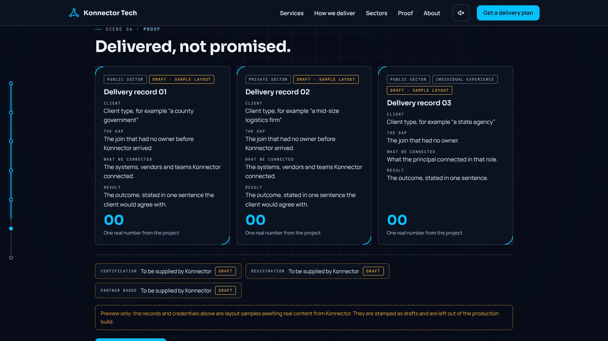
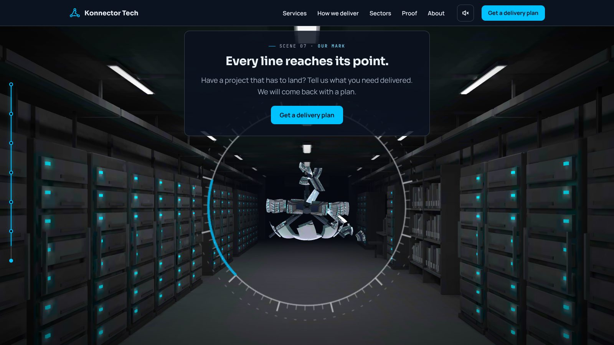
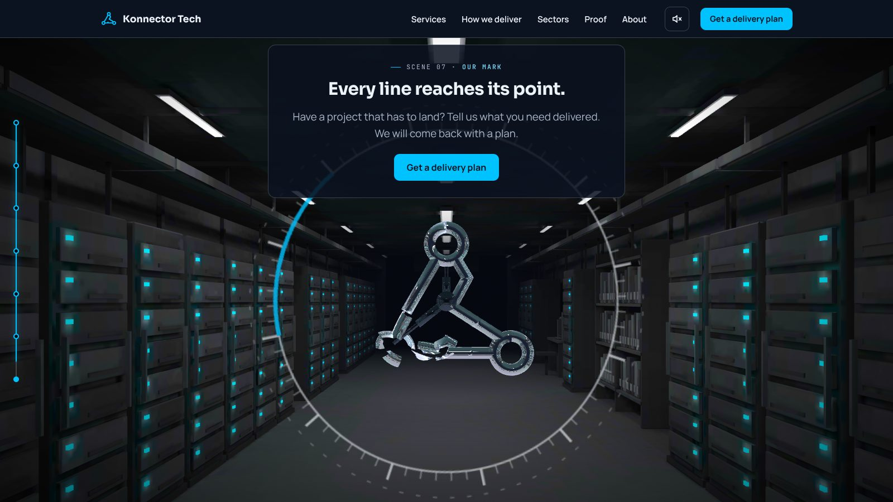

# Phase 4 gate: final art

**Gate:** the frame-rate budgets hold on the Full and Light tiers (60 frames per second on Full, never under 30 on Light).
**Status: not signed off. Two things only the owner can settle are listed at the end.**

The art in this phase follows my recommendations where the owner had not chosen. It is not locked.

## What changed

| Script item | Result |
| --- | --- |
| Corridor modelled in Blender with lighting baked into textures | Done. Two bakes: dim (scene 1) and lit with cyan status lights (scene 7). |
| glTF with Meshopt compression and KTX2 textures | Done. 2048 px textures on Full, 640 px on Light. |
| Same model drawn with two materials, chosen per pixel by a mask of lens, sweep and blend | Done. The baked mesh is the real look; a Blender-exported line set is the blueprint. |
| Mirror-chrome sphere reflecting an environment rendered from the room | Done. The room is now wider and brighter so the sphere has something to reflect. |
| Transformation animated in Blender as 30 to 40 plates, exported as one clip, clip time set by the scroll | Done. 36 plates, a hub and three pistons, one clip named "Transform", 4 seconds. Plays by itself on phones. |
| Grain and darkened edges on Full only | Done (as overlays). |
| Bloom on cyan, Full only | **Different from the script.** A soft cyan halo around the line and glow on the three nodes, with no bloom pass. A true bloom would also glow the white strip lights, which the script's "glow only on cyan" rule forbids. |
| Sound, off by default | In place: room hum, click when rings lock, rising tone for the transformation. |
| One still per scene for brief mode, and the share image | Re-rendered from this art. |
| 8-second logo reveal video | Re-exporting from this art (`public/media/logo-reveal.mp4`). |

## Frames (desktop, Full tier)

| Scene | Frame |
| --- | --- |
| 1 Arrival |  |
| 2 The scan |  |
| 3 The line |  |
| 4 The run |  |
| 5 Two doors |  |
| 6 Proof |  |
| 7 Transformation, plates opening |  |
| 7 Transformation, plates locking |  |
| 7 The mark and the form |  |

Blender's own ray-traced preview of scene 1, for comparison with the browser:

## Budgets

| Budget | Measured | Limit |
| --- | --- | --- |
| First load (page + script, compressed) | 171 KB | 200 KB |
| Full tier: 3D code + models | 2.26 MB | 3 MB |
| Light tier: 3D code + models | 1.47 MB | 1.5 MB |
| Frame rate, Full | **Not measured** | 60 |
| Frame rate, Light | **Not measured** | never under 30 |

All 35 browser tests and 10 form tests pass.

## Why the gate is not signed off

1. **Frame rate cannot be measured here.** This environment has no graphics card and draws in software, so any number from it would be meaningless. To check on real devices, open the preview with `?fps=1` added to the address: a small readout shows the tier, the current frame rate and the lowest seen. A desktop should hold about 60; a phone should never drop under 30.
2. **The plate design departs from the script in one respect.** The script asks for rigid plates. Each plate lifts off and turns as a rigid piece, then rolls into its piece of the mark. Fully rigid curved plates cannot form the mark's rings exactly. The alternatives are a second set of rigid mark pieces hidden inside the sphere, or plates that clamp onto an inner frame as armour. This is a matter of taste and is the owner's call.

## Also open

- Scene 2: two labels on the same wall are close but no longer overlap. "Records" sits near the edge of the frame.
- The modelling is scripted and plain: racks, trays, shelves and a terminal as clean boxes. A 3D artist can replace the model files without code changes.
- Real phones, Safari and Firefox are untested.
