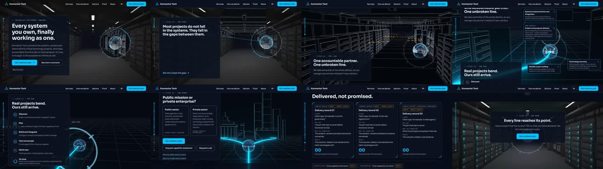

# Phase 5 gate: hardening

The script's Phase 5 is: "Finish the device tiers, the accessibility pass, device testing, tuning and redirects.
Gate: every acceptance criterion below is met." This page takes each criterion in turn, says what the evidence is,
and says plainly where the evidence stops.

Everything is on the pull request branch and the preview. Nothing is merged and nothing is deployed to production.

## Where it stands

| | Acceptance criterion | Status | Evidence |
| --- | --- | --- | --- |
| 1 | A first-time visitor can read the headline and press the main button within 2.5 seconds on a mid-range phone | **Met on an emulated phone.** Not yet timed on a real one. | Test with slow 4G and a 4x slower processor. Story mode: headline and main button usable at 1.7 s. Brief mode: largest paint at 2.1 s, layout shift 0. |
| 2 | All seven scenes play forward and backward with the scroll, with no jumps | **Met** (Full tier). | Test scrolls the whole page in quarter-screen steps, down then up. Story time only ever advances on the way down, never by more than the step allows, and every position gives the same moment on the way back. |
| 3 | The sphere stays on screen from scene 1 until it becomes the mark | **Met, with scene 6 as the script directs.** | Test samples 71 moments from start to end. The sphere is inside the frame at every one where the 3D is showing. The only moments it is not showing are inside scene 6, where the script says "The 3D rests here". |
| 4 | The line never breaks between scene 3 and the form | **Met, with the same note on scene 6.** | Test: the line is one tube that is always drawn from its start and only ever grows through scenes 3 and 4; both branches are drawn from the fork in scene 5; in scene 7 the line arrives and joins the mark, with the form directly beneath. |
| 5 | Brief mode shows every message and every button that the full story shows | **Met.** | Tests: every scene heading, all three asks, the form, with scripts on and with scripts off. |
| 6 | The whole site works by keyboard and passes WCAG 2.2 level AA checks | **Met for automated checks.** No screen reader session by a person yet. | See "Accessibility pass" below. |
| 7 | The performance budgets pass in the build pipeline | **Met.** | The pipeline runs the budget script and the tests on every push. Figures below. |
| 8 | A test enquiry is stored, emailed and confirmed, and a failed send keeps the visitor's text | **Stored, confirmed and kept: met. Emailed: tested with a stand-in mail service only.** | Tests cover storing, the on-page confirmation, a failed send, and text typed before the script loads. Real email needs the mail and bot-check keys, which are deferred with the CRM endpoint. |
| 9 | Every event in the measurement list is recorded | **Met.** | Test fires and checks each event. |
| 10 | No placeholder text or invented proof is live | **Guarded, not yet met for launch.** | A production build refuses to build while any draft item remains. Today it lists 3 sample records, 7 company facts, the capability statement, the booking link and the bot-check key. These are the owner's to supply. |

**My reading:** criteria 2, 3, 4, 5, 7 and 9 are met. Criteria 1, 6 and 8 are met as far as a machine can show and
each needs one check by a person. Criterion 10 cannot be met until the content arrives. So the gate is ready for
review, and launch (Phase 6) stays blocked on content.

## The phone's 1% low (carried from Phase 4)

Measured: 58 average, 1% low 29, no stalls over 50 ms, 990 frames. With no frame over 50 ms, a 1% low of 29 means
about ten frames that each took two screen refreshes instead of one. The target is fewer of those.

| Change | Why |
| --- | --- |
| Reflections refresh one face of the cube per frame, over six frames | They were drawn six at once. That one frame carried six extra room draws, enough to miss a refresh on a phone. The cost is now spread flat. |
| The forced refresh when nothing has changed runs far less often | It redrew all six faces every three seconds for no visible gain. |
| Less memory churn each frame | Fewer short-lived objects for the browser to clean up mid-scroll. |
| The story re-reads the scroll position every frame | It could sit one step behind the scroll until the next scroll event. Found by the new forward-and-backward test. |

Heaviest frame per scene, in draw calls, before and after (typical frames are unchanged):

| Scene | Light before | Light now | Full before | Full now |
| --- | --- | --- | --- | --- |
| 2 The scan | 57 | 68 | 163 | 142 |
| 3 The line | 132 | 107 | 165 | 134 |
| 4 The run | 144 | 102 | 217 | 178 |
| 5 Two doors | 109 | 84 | 195 | 160 |
| 7 Transformation | 64 | 67 | 151 | 151 |

Laptop speed is not put at risk: the same work is done, spread over more frames.

**Not proven.** There is no graphics chip here, so this is the most likely cause addressed, not a measured result.
It needs the one phone reading agreed for the end of this phase. Scene 7's own peak did not move in the table,
so if the phone still reads 29 there, the next place to look is the chrome mark itself, which fills much of the
screen at the end.

## Accessibility pass

Automated checks (axe, WCAG 2.0, 2.1 and 2.2 at levels A and AA) now cover 13 pages and 6 states of the story:

- Pages: home (brief), contact, public sector, private sector, services index, two service pages, how we deliver,
  proof index, a proof record, about, privacy notice, and the page-not-found page.
- Story mode: arrival, the scan with a gap chosen, the line with its panels docked, the run, two doors with one
  chosen, and the form with its error messages showing.

Result: no serious or critical issues. Two real faults were found and fixed on the way:

1. **The progress rail's stops were 22 px.** WCAG 2.2 asks for targets of at least 24 px. They are now 24 px.
2. **Choosing a door faded the other door's text below the contrast floor.** The unchosen door now steps back
   through its frame and heading colour; its text stays readable.

Also checked by test:

- Keyboard in story mode: Tab reaches the header, the rail, the gap cards, the doors and the form, and every stop
  shows a focus ring.
- The canvas and the labels drawn over it are hidden from screen readers; every scene keeps its heading as page text.
- Reduced motion, data saver, a slow connection and no 3D each open brief mode by themselves.

By reading the code: the strip light changes level 2.3 times a second, by at most 22% of its brightness, with a
smooth blend between levels. That is under the limit of three flashes a second.

Not done: a session with a real screen reader (VoiceOver or NVDA). Automated checks find only part of what WCAG
covers, so this is worth half an hour of a person's time before launch.

## Device tiers and device testing

| What | How it was checked | Result |
| --- | --- | --- |
| Tier choice | Tests pretend to be 11 kinds of device and browser setting | Each lands on the tier the script names |
| Step-down ladder | Test forces slow frames | Full, Light, Light at lower resolution, then brief mode, staying at the same moment of the story |
| Chrome on a laptop with basic graphics | Owner, real device | Light tier, average 60, 1% low 42, no stalls |
| Chrome on Android | Owner, real device | Light tier, average 58, 1% low 29, no stalls |
| Chromium | Pipeline, all 57 tests | Pass |
| Safari's engine (WebKit) | Pipeline, 4 tests including the story starting | Pass |
| Firefox | Pipeline, 4 tests | Pass in brief mode. The pipeline's Firefox had no 3D, so the story did not run there. It is now asked to draw in software; the next run will show whether that works. |
| A browser with 3D turned off | Test | Brief mode, and "Play the story" is not offered |
| Interaction delay | Test on an emulated phone, 4x slower processor, brief mode | Tap on a gap card 72 ms, a door 48 ms, a form field 32 ms, a key press 24 ms, against a limit of 200 ms |

**Needs a person, and cannot be done from here:**

1. Safari on an iPhone, and Safari on a Mac: play the story once, send the form once.
2. Firefox on a laptop: play the story once.
3. One older phone: confirm it opens in Light or brief mode and scrolls without catching.
4. The phone reading for the 1% low.

## Recording of all seven scenes

`phase-5/story.mp4` (24 seconds, 1280 x 720) is the whole story with the final art, Full tier, from arrival to the
mark. `phase-5/story-frames.jpg` is eight frames from it side by side.

It is drawn frame by frame on a machine with no graphics chip and then joined up, so it shows what each moment
looks like, not how smoothly the page runs. Smoothness is what the `?fps=1` readings on real devices are for.

## Redirects

The live site is one page, so there are no old page addresses to redirect. Its section links are kept: `#services`,
`#how`, `#sectors`, `#about` and `#contact` each land on the matching part of the new home page (checked by test),
and `#top` still works. The sitemap lists every new page. The live site's files are untouched.

## Budgets (from the pipeline's own script)

| Budget | Limit | Now |
| --- | --- | --- |
| First-load script and page, compressed | 200 KB | 171.7 KB |
| 3D code in the first load | none | none |
| Light tier: 3D code and models | 1.5 MB | 1.12 MB |
| Full tier: 3D code, texture decoder and models | 3 MB | 2.20 MB |
| Hero still images | 200 KB | 142.9 KB |

## Added after the gate was written: frontier technology

A new ordinary section, "Frontier technology, landed", sits between scene 5 and scene 6 on the home page, with three
cards: Koniku, QVITI and RSQ HOLO. Konnector is shown as the integrator, not the inventor. All three serve both
public and private sector customers: each card lists both sides, and all three appear on the public sector page and the
private sector page with that side's fit, linking back to the full card.

- It is text only: no new 3D, no images, no logos. The 3D rests while it is on screen, as it does for the proof.
  First-load size went from 171.7 KB to 174.5 KB (limit 200 KB). 3D sizes are unchanged.
- Each "what it is" line is the company's own description, attributed to it. Konnector makes no claim for the
  products. The word "partner" is not used for them.
- The three descriptions were checked against the companies' sites and cleared by Gbenga on 12 Nov 2026, with text
  names only. The draft stamps are removed; the cards are part of a production build.
- Tests cover the three cards, the text-only rule, the order on the page, the sector-page links, and an
  accessibility scan of the section in story mode.

## What the owner still holds

- Content for launch: at least two delivery records, credentials and registrations, the capability statement PDF,
  the booking link, and a read of the privacy notice and the reply promise.
- The four device checks above.
- Keys for email and the bot check, with the CRM endpoint, after the site is approved.
